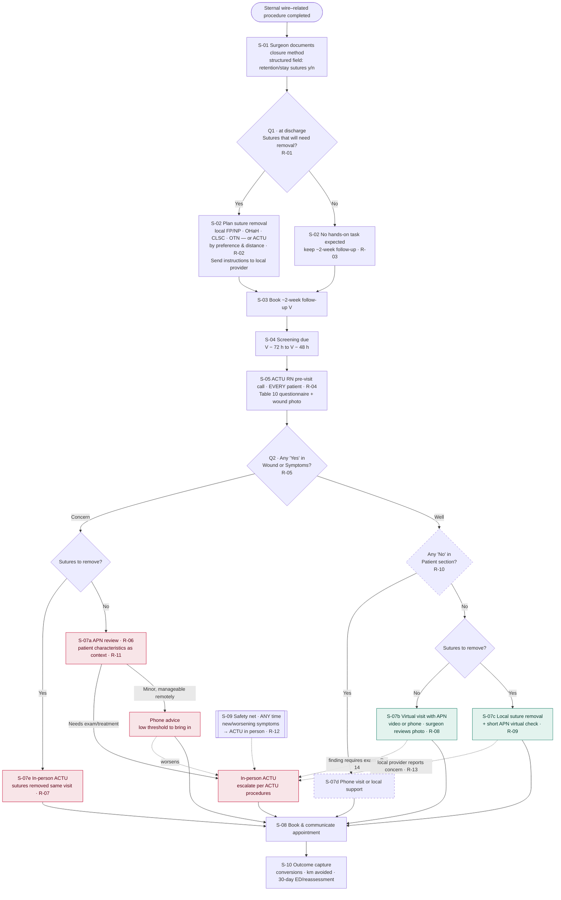

# ACTU Virtual Follow-Up Pathway — Specification

> **Source:** *Virtual Follow-Up After Sternal Wire–Related Procedures: An Evidence-Informed Clinical Decision Pathway and Implementation Framework for the Acute Cardiac Triage Unit* (UOHI MHA Final Field Project Report, Dec 2026). Section, table and figure numbers below refer to that report.
>
> **Status:** Draft for Checkpoint 1. Nothing here has been clinically validated. Where the report is ambiguous, the item is listed under [§8 Open questions](#8-open-questions) and **not** resolved in this spec. Rule IDs (`R-xx`) and step IDs (`S-xx`) are stable and will be reused in code, tests and `docs/traceability.md`.
>
> **Update (Nov 26, 2026):** The build is now a two-agent proof of concept. See [`poc-plan.md`](poc-plan.md). It resolves OQ-05 and OQ-16 and adopts the slide-8 decision rule.

---

## 1. Pathway summary

### 1.1 Goal
Match each patient's **first post-procedure follow-up** to clinical need, instead of defaulting to an in-person ACTU visit about 2 weeks after the procedure. The aim is *appropriate* care, not the highest possible virtual rate (Table 17 note). The pathway rests on **two questions**:

| # | Question | When / who (as stated in the report) |
|---|---|---|
| **Q1** | *Are there sutures that will need removal?* | At discharge, from the OR-note closure method; surgical APN (Fig. 7, Table 11). **See OQ-04:** Table 8 instead says 48–72 h before follow-up, by the ACTU RN. |
| **Q2** | *Are there any new or ongoing clinical concerns?* | Nurse call **48–72 h before the scheduled ~2-week follow-up**, **every patient**, with a wound photo where possible; ACTU RN (Fig. 7, Tables 8, 10, 11). |

Combining the answers routes each patient to one of four follow-up options (Table 9, Fig. 7). Two further routes exist for digital barriers and for escalation (see §4).

### 1.2 Patient population
- Patients **with a previous median sternotomy** who then underwent a **sternal wire–related procedure** at UOHI: wire removal or tightening, rewiring with fixation, debridement, or wound closure (§1.2, §2 scope).
- They come from a single surgical practice (§1.2).
- The pathway covers the **post-procedure follow-up**, scheduled about 2 weeks after the procedure (observed median 18 days, IQR 14–19.5; Table 6).
- Follow-up takes place in the ACTU, an outpatient triage unit that sees patients referred by UOHI cardiologists and cardiac surgeons (§1.1).

### 1.3 Inclusion criteria (explicit in the report)
1. Previous sternotomy **and**
2. A sternal wire–related procedure (removal, tightening, rewiring/fixation, debridement, closure) **and**
3. A post-procedure follow-up is planned (~2 weeks).

**Patients with retention/stay sutures are explicitly included** (Rec. 3, §6.3, §7.5).

### 1.4 Exclusion criteria
The report gives **no explicit exclusion criteria** for the post-procedure pathway. It does say:
- **The initial pre-procedure assessment stays in person** (§3, Fig. 2). It is outside this pathway.
- **Patient characteristics are never an exclusion on their own.** Age, sex, diabetes, BMI, smoking, comorbidities, previous sternal wound infection and distance are *context for the APN's judgment* (Table 8, §6.3, Fig. 7). → `R-11`
- **Self-removal of sutures is not recommended** (Table 12 note). → `R-15`

Whether anything else excludes a patient (for example, admission elsewhere, or the patient declining follow-up) is **OQ-07**.

---

## 2. Actors and roles

From Table 11, Table 4, Table 12 and Fig. 7. "Sees / does" describes what the role does in the pathway; the screens for each role come in Phase 3.

| Actor | What they see | What they do | Source |
|---|---|---|---|
| **Patient** (with family / caregiver) | Follow-up instructions, red-flag education, appointment details; in future, a MyChart questionnaire and wound-photo upload | Answers the pre-visit call; sends a wound photo (alone or with family help); attends the visit (virtual, phone, local or ACTU); contacts the team if symptoms change (safety net) | Tables 10, 12, 14; Fig. 7 |
| **Surgeon** (cardiac surgery) | OR note; wound photos of virtual-visit patients; escalated cases | Documents the closure method (sutures to remove: yes/no) as a **structured field**; reviews the wound photo for virtual visits; decides visit type together with the APN when a concern is found | Table 11; Fig. 7 |
| **Surgical APN** (advanced practice nurse) | OR note / closure method; discharge plan; patient context (distance, family physician, province) | **Answers Q1 at discharge**; plans suture removal (local or ACTU); sends removal instructions to the family physician or community nurse; books the follow-up | Table 11 |
| **APN** (reviewing / virtual visit) — *may be the same person as the surgical APN, see OQ-13* | Screening result, questionnaire answers, wound photo, patient characteristics, (future) AI summary | Reviews every patient with a concern and decides between in-person ACTU, phone advice and escalation; runs virtual visits; runs the short virtual check after local suture removal; **makes every final decision** | Tables 8, 9, 11, 14; Fig. 7 |
| **ACTU registered nurse** | Worklist of upcoming ~2-week follow-ups; OR note; wound photo | **Answers Q2**: calls every patient 48–72 h before the visit, completes the questionnaire, reviews the wound photo, documents the screening | Tables 8, 10, 11 |
| **ACTU scheduling / virtual care team** | Visit-type decision | Books and communicates the appointment (confirmed appointment + instructions) | Table 11 |
| **Family physician / NP** | Removal instructions from UOHI | Removes sutures close to home; reports any concern back to the ACTU | Tables 11, 12 |
| **Community nurse** (Ontario Health atHome clinic; CLSC in Quebec) | Removal instructions | Same as above, for patients without a family physician (OHaH) or Quebec residents (CLSC) | Table 12 |
| **OTN local nurse** at an Atlas Alliance hospital | — | Presents the patient for an assisted exam while a UOHI clinician joins by video (patients far from Ottawa who were flagged) | Table 12 |
| **Responsible clinical team** | New concerns | Responds to new concerns **at any time** (reassessment, escalation) | Table 11 |
| **ACTU manager / nurse champion / surgeon sponsor** | Pilot measures, progression criteria | Owns the pathway; monthly case review; continue / adapt / stop decision | Tables 13, 16–18 |

> The report names **no cardiologist or "coordinator" role** in this pathway. See OQ-01.

---

## 3. Step-by-step flow

Timing is relative to **T0 = procedure / discharge date** and **V = the scheduled ~2-week follow-up date**.

| Step | Name | Trigger | Timing | Owner | Inputs | Outputs |
|---|---|---|---|---|---|---|
| **S-01** | Document closure method | Sternal wire–related procedure completed | Intra-/post-op (T0) | Surgeon | Operative findings | OR note with **structured closure field**: retention/stay sutures yes/no (`R-01`) |
| **S-02** | Q1 — suture-removal planning | Discharge | At discharge (T0) — *see OQ-04* | Surgical APN | Closure field; patient preference; distance; has family physician; province | Q1 answer. If yes: removal location planned (`R-02`) and instructions sent to the local provider. If no: no hands-on task expected (`R-03`) |
| **S-03** | Book follow-up | Discharge | T0, for V ≈ T0 + 14 d | Surgical APN (Table 11) / scheduling team | Q1 outcome | Booked ~2-week follow-up placeholder |
| **S-04** | Pre-visit screening becomes due | Calendar | **V − 72 h to V − 48 h** | System → ACTU RN worklist | Booked V date | Screening task on the RN worklist |
| **S-05** | Q2 — pre-visit screening call | S-04 due | V − 72 h … V − 48 h | ACTU RN | Questionnaire (Table 10); wound photo (MyChart) if available; OR note | Completed questionnaire, wound photo (or "unable"), screening documented (`R-04`, `R-05`, `R-10`) |
| **S-06** | Route | S-05 completed | Immediately after S-05 | System proposes; **clinician confirms** (`R-16`) | Q1 + Q2 + digital-readiness answers | One route (see §4.2): APN review / virtual visit / local removal + APN check / phone visit or local support |
| **S-07a** | APN review (concern) | Route = concern | Before V (*no SLA in report, OQ-09*) | APN (with surgeon) | Questionnaire, photo, patient characteristics | Decision: in-person ACTU, phone advice, or escalation per ACTU procedures (`R-06`, `R-07`) |
| **S-07b** | Virtual visit | Route = well + no sutures + digitally ready | At V | APN; surgeon reviews photo | Photo, questionnaire | Visit documented; convert to in-person if needed (`R-08`, `R-14`) |
| **S-07c** | Local suture removal + APN virtual check | Route = well + sutures (local plan) | Removal: *date not specified (OQ-10)*; APN check: *timing not specified (OQ-10)* | Family physician / community nurse; APN | Removal instructions | Removal done; concerns reported back (`R-09`, `R-13`) |
| **S-07d** | Phone visit or local support | Any "No" in the Patient (digital readiness) section | At V | APN / ACTU | — | Visit documented (`R-10`) |
| **S-07e** | In-person ACTU visit | APN decision, sutures + concern, conversion, or safety net | At V or sooner | ACTU team | — | Visit; sutures removed at the same visit if present (`R-07`) |
| **S-08** | Book and communicate appointment | Visit type decided | After S-06 / S-07a | ACTU scheduling / virtual care team | Visit type | Confirmed appointment and instructions to the patient |
| **S-09** | Safety net | New or worsening symptoms reported by the patient or a local provider | **Any time** | Responsible clinical team | Report | ACTU in-person reassessment / escalation (`R-12`, `R-13`) |
| **S-10** | Outcome capture for pilot measures | Visit completed | V … V + 30 d | ACTU / analytics | Visit outcome; unplanned reassessment / ED within 30 days | KPI data (§6) |

**Future steps (roadmap Phases 3–4, Table 14, Table 15). These are not part of the near-term pathway (§8.1 "no AI needed"):**
- **S-F1** MyChart sends the questionnaire and photo request at **V − 72 h**, with a reminder at **V − 48 h** and a **nurse call at V − 24 h if still incomplete**. *Note: this differs from the near-term 48–72 h nurse call (OQ-05).*
- **S-F2** AI review of the photo, answers and chart produces a suitability estimate with reasons and flags. **The APN decides** (`R-16`).

---

## 4. Decision points and escalation rules

### 4.1 Rules as stated in the report

| ID | Rule | Source |
|---|---|---|
| **R-01** | *Sutures to remove* = **Yes** when the OR-note closure method includes retention or stay (non-absorbable) sutures. Otherwise **No** (absorbable closure). | Fig. 5, Fig. 7, §6.5, Table 11 |
| **R-02** | Q1 = Yes → plan suture removal **close to home** (family physician/NP, OHaH community nursing clinic, CLSC in Quebec, OTN at an Atlas Alliance hospital) **or at the ACTU**, according to patient preference and distance. | Fig. 7, Table 12 |
| **R-03** | Q1 = No → keep the ~2-week follow-up, with a call before the visit. | Fig. 7 |
| **R-04** | Q2 screening is done for **every** patient, **including** those with sutures to remove. Q1 never bypasses Q2. | Fig. 7, Table 8, §7.3 |
| **R-05** | **Concern** = any "Yes" in *Wound* or *Symptoms* (Table 10): incision opening or gap; drainage or spreading redness; protruding suture or wire; fever or chills; new or worse chest pain or shortness of breath; dizziness or abnormal heart rate / blood pressure. → **APN review**. | Table 10 |
| **R-06** | Concern **and no sutures** → **APN decides**: in-person ACTU, or phone advice ("minor issue the APN can manage remotely, with a low threshold to bring in"). Needs examination or treatment → in-person, **escalate per ACTU procedures**. | Table 9, Fig. 7 |
| **R-07** | Concern **and sutures** → **in-person ACTU**, with sutures removed at the same visit. | Table 9 |
| **R-08** | No concern **and no sutures** (and digitally ready) → **virtual visit with the APN** (video or phone); the **surgeon reviews the photo**. | Table 9, Table 10, Fig. 7 |
| **R-09** | No concern **and sutures** → **local suture removal + a short APN virtual check**. | Table 9, Fig. 7 |
| **R-10** | Any "No" in the *Patient* section (device with camera; reliable internet; able to send a photo; willing to have a video or phone visit) → **phone visit or local support**. | Table 10, Fig. 7 safety net |
| **R-11** | Patient characteristics (age, diabetes, comorbidities, smoking, BMI, previous sternal wound infection, distance) **inform the APN's review** and are **never an automatic exclusion**. | Table 8, Fig. 7, §6.3 |
| **R-12** | **Safety net:** new or worsening symptoms at any time → **ACTU in person**. | Fig. 7, Table 11 |
| **R-13** | Local provider (family physician / community nurse) finds a concern → reports back to the ACTU → reassessment. | Table 11 |
| **R-14** | A virtual visit may be **converted to in-person**. Conversions are tracked as a KPI. | §10.1, Table 17 |
| **R-15** | **Patient self-removal of sutures is never offered.** | Table 12 note |
| **R-16** | **A clinician makes every final routing decision.** The system and any future AI only recommend. | Exec. summary Rec. 4, Table 14, §8.3–8.4 |
| **R-17** | Possible **protruding sutures** in a patient without retention sutures (e.g., needing trimming) should be detected from the wound photo. This falls under the *protruding suture or wire* item in R-05. | Table 9 note |

### 4.2 Routing matrix (Table 9 combined with Table 10)

|  | **No sutures to remove** | **Sutures to remove** |
|---|---|---|
| **Well** (no "Yes" in Wound/Symptoms) | Virtual visit with APN (`R-08`) | Local removal + APN virtual check (`R-09`) |
| **Concern** (any "Yes" in Wound/Symptoms) | APN decides: in-person ACTU or phone advice (`R-06`) | In-person ACTU; sutures removed at the same visit (`R-07`) |
| **Any "No" in Patient section** | Phone visit or local support (`R-10`) — **how this combines with the cells above is unclear: OQ-02** | ← same |

### 4.3 Thresholds
The report gives **no numeric clinical thresholds**: no temperature for "fever", no heart-rate or blood-pressure limits for "abnormal", no pain scale, no time limit for an APN response. Every symptom item is a patient-reported **Yes/No**. → **OQ-08**. ED / 911 criteria are not defined; escalation is "per ACTU procedures" → **OQ-06**.

---

## 5. Data captured at each step

| Step | Data element | Type | Source |
|---|---|---|---|
| S-01 | Procedure type (removal / tightening / rewiring-fixation / debridement / closure); procedure date | coded + date | §1.2 |
| S-01 | **Closure method: retention or stay sutures (yes/no)** | boolean (structured) | Rec. 2, Table 11 |
| S-02 | Q1 answer; planned removal location (ACTU / family physician-NP / OHaH clinic / CLSC / OTN); patient preference; instructions sent (to whom, when) | coded | Fig. 7, Tables 11, 12 |
| S-02 | Context: has family physician (y/n), province (ON/QC), one-way distance to UOHI (km) | mixed | Table 12, Table 6 |
| S-03 | Follow-up date (V); appointment | date | Table 11 |
| S-05 | **Questionnaire (10 Yes/No items, Table 10)** — Wound (3): opening/gap; drainage/spreading redness; protruding suture/wire. Symptoms (3): fever/chills; new/worse chest pain or SOB; dizziness/abnormal HR/BP. Patient (4): smartphone/tablet with camera; reliable internet; able to send photo (alone or with help); willing to have video/phone visit | boolean × 10 (possible additions: OQ-12) | Table 10 |
| S-05 | **Wound photo** (or reason not available); photo usable (y/n) | image + boolean | §7.3, Table 18 |
| S-05 | Screening completed by, date/time; call outcome (reached / not reached) | audit | Table 11 |
| S-05 | Nursing time per screening (minutes) | number | Table 17 (balancing) |
| S-06/07 | Route recommended; route chosen; decided by; rationale (free text) | coded + text | Tables 9, 11 |
| S-07 | Visit modality actually delivered (video / phone / in-person / local); converted to in-person (y/n, reason) | coded | Table 17 |
| S-07c | Suture removal done (date, by whom); concern reported back (y/n, details) | mixed | Table 11 |
| S-10 | Unplanned reassessment or ED visit within 30 days; delayed recognition of a concern | boolean + date | Table 17 |
| S-10 | Patient-reported convenience; patient and clinician acceptability | survey (instrument not specified, OQ-14) | Table 17 |
| Context | Patient characteristics shown to the APN: age, sex, BMI, diabetes, hypertension, COPD, OSA, smoking, previous sternal wound infection, number of conditions | read-only | Table 6, Fig. 6 |

**Not captured by the pathway:** structured vitals (HR, BP, temperature), medications, and labs. The report does not ask for them. See OQ-08.

---

## 6. Outcomes and KPIs

### 6.1 Pilot measures (Table 17)

| Type | Indicator | Definition gaps |
|---|---|---|
| Process | **Eligible patients screened before the visit (%)** | Denominator not fixed (OQ-14) |
| Process | **Virtual visits completed**; **conversions to in-person (%)** | |
| Outcome | **Round-trip km avoided**; patient-reported convenience | Report's method: round trip = 2 × one-way distance |
| Outcome | **Patient and clinician acceptability** | Instrument not specified |
| Balancing | **Unplanned reassessment or ED visit within 30 days** | 30 days from what event? (OQ-14) |
| Balancing | **Delayed recognition of concerns**; **nursing time per screening** | "Delayed recognition" not defined |

Also from Table 2: virtual visit completion, avoided travel, unplanned reassessments, and patient and clinician feedback (consistent with the above).

### 6.2 Progression criteria (Table 18 — proposed thresholds, to be agreed)

| Criterion | Stop and review | Proceed with changes | Proceed |
|---|---|---|---|
| Eligible patients screened before the visit | < 50% | 50–79% | ≥ 80% |
| Screened patients who send a usable wound photo (alone or with help) | < 40% | 40–79% | ≥ 80% |
| Virtual visits converted to in-person | > 30% | 15–30% | < 15% |
| Safety events linked to a missed finding in the virtual pathway | **Any → pause and review each case** | n/a | None |

The pilot is a **one-month PDSA cycle** (Table 16), with a monthly case review (Table 13).

---

## 7. Flowchart

*The dashed nodes (`DIG`, `PHONE`) show where the report doesn't say how the digital-readiness rule combines with the clinical rules (OQ-02). The order drawn here (clinical concern checked first) is **provisional** and is only there so the diagram can be drawn.*

---

## 8. Open questions

Please answer by ID. **I have not encoded an answer to any of these.**

### A. Scope: the project brief vs. the report

- **OQ-01 — Population and framing.** The brief describes *"virtual follow-ups of patients discharged from the ACTU"*, with a *cardiologist* and a *coordinator*, and timing like *"48–72 h post-discharge"*. The report covers something narrower: **patients after a sternal wire–related procedure**, followed up **in** the ACTU about 2 weeks later, with a nurse call **48–72 h *before* the follow-up visit** (not after discharge). Its actors are the surgeon, APN, ACTU RN and scheduling; there is no cardiologist or coordinator. **Should the app implement exactly the report's pathway?** Or should it be a general ACTU follow-up platform, with this pathway as the first configured one? If you want a cardiologist or coordinator role, what do they do?
- **OQ-02 — Precedence of the digital-readiness rule.** Table 10 says: any "Yes" in Wound/Symptoms → APN review; any "No" in Patient → phone visit or local support; all clear → virtual visit. What happens when a patient has **both** a concern and a digital barrier? I assume the concern wins, but please confirm. And when a **sutures** patient is well but has a digital barrier, is local removal still the route, with the APN check done by phone?
- **OQ-03 — "Willing to have a video or phone visit? = No".** The rule sends any "No" to a *phone visit*, which contradicts a patient who isn't willing to have a phone visit. Should that answer route to **in-person ACTU**?
- **OQ-04 — When and by whom Q1 is answered.** Fig. 7 and Table 11 say **at discharge, by the surgical APN**. Table 8 says **48–72 h before follow-up, by the ACTU RN reviewing the OR notes**. Which one? Or should Q1 be set at discharge and re-checked by the RN on the call?
- **OQ-05 — Screening window and channel.** The near-term pathway is a nurse call at V − 72 h to V − 48 h. The future MyChart concept is a request at V − 72 h, a reminder at V − 48 h, and a nurse call at **V − 24 h** if incomplete. Is the MyChart / patient self-report flow **in scope for this app** (a patient-facing check-in), or only the clinician-run call (roadmap Phase 1)?

### B. Clinical logic not defined in the report

- **OQ-06 — Escalation and ED.** Fig. 7 says "escalate per ACTU procedures". Are there **red flags that should send a patient directly to the ED / 911** (e.g., chest pain with specific features) rather than to APN review? The report doesn't define any, so the app will only show "APN review", with no ED rule, unless you give me one.
- **OQ-07 — Exclusions and edge cases.** How should the pathway handle (a) a patient **admitted elsewhere** before V (2 cohort cases), (b) a patient who **declines** follow-up because they feel well (the PIFU option, Table 12 / Rec. 10.3), (c) **more than one procedure date**, (d) Quebec / out-of-province patients?
- **OQ-08 — Thresholds.** Should the symptom items stay **patient-reported Yes/No** (as in Table 10)? Or do you want numeric thresholds (temperature, HR, BP, pain score) captured as vitals? If so, please give the values. I won't invent them.
- **OQ-09 — Unreachable patient / incomplete screening.** What happens if the RN can't reach the patient in the 48–72 h window? How many attempts? Does the visit stay in person by default? And what is the expected **time to APN review** after a concern is flagged?
- **OQ-10 — Local suture removal timing.** On what day after the procedure should local removal happen (the report cites ">14 days" only from WISDOM)? Is the APN virtual check **before or after** removal, and is it held at V? How does the ACTU confirm that removal happened?
- **OQ-11 — Who reviews the wound photo.** Table 8 says the **ACTU RN** reviews it on the call. Fig. 7 says the **surgeon** reviews it for virtual visits. Are both required? Does the surgeon's review block the virtual visit?
- **OQ-12 — Questionnaire completeness.** Fig. 7 lists **"new or worse pain"** (sternal pain) as a concern, but Table 10 only asks about *chest pain or shortness of breath*. Should a separate sternal/incisional pain item be added? Should "opening or gap" and "drainage or spreading redness" be split into separate items for the record?

### C. Roles, KPIs and data

- **OQ-13 — APN roles.** Are the **surgical APN** (Q1 at discharge) and the **APN** who does review and virtual visits the **same role**? For app permissions: is this one role or two?
- **OQ-14 — KPI definitions.** The report leaves these open: the **denominator** for "eligible patients screened" (patients, planned visits or encounters); the **anchor for the 30-day window** (procedure, discharge or the follow-up visit); the definition of "delayed recognition"; and the acceptability instrument. Should the app compute the KPIs with defaults that you set, or just capture raw data for analytics?
- **OQ-15 — Distance.** "Round-trip km avoided" needs the patient's distance to UOHI. Should the app compute it from the patient's address (geocoding = PHI sent to an external service, so I'd avoid it), take it as a manually entered field, or use a postal-code lookup table?

### D. Epic / implementation (to be resolved in Phase 2, listed now so it isn't lost)

- **OQ-16 — AI-assisted review (roadmap Phase 4).** The report treats this as future work under governance (Copilot is the only approved AI tool; PHIPA review needed). Should the app include **any** AI summary (e.g., via the MCP server) in this build, even on sandbox data? Or should it be left out and only stubbed as an interface?
- **OQ-17 — Sandbox cohort.** The Epic sandbox test patients won't have sternal wire procedures or closure-method fields. Is it acceptable to **tag selected sandbox patients locally** as pathway patients (with a synthetic procedure date, closure method and V date stored in the app's own database) so the worklist can be exercised?

### E. Editorial issues in the report (FYI, not blocking)

- §4.2 still contains a highlighted old heading ("Mixed-methods approach") and a Persian-language drafting note.
- Some in-text table references are off by one: §7.2 refers to "Table 10" for Table 9; §7.5 refers to "Table 13" for Table 12; §8.2 refers to "Table 14" for Table 13; §9 refers to "Table 19" for Table 18.
- Table 3 gives the period as "January 2025 – November 2026", while the methodology box (§4.2) says "Jan 2026–Nov 2026".
- Table 6 footnote ᶜ ("Not documented for 2 patients") isn't attached to any row.
- Table 9 gives 13 + 9 = 22 of 23 patients without sutures. The 23rd (patient 37, suture trimmed) appears in Fig. 5's "no concern" group but not in Table 9's counts.
