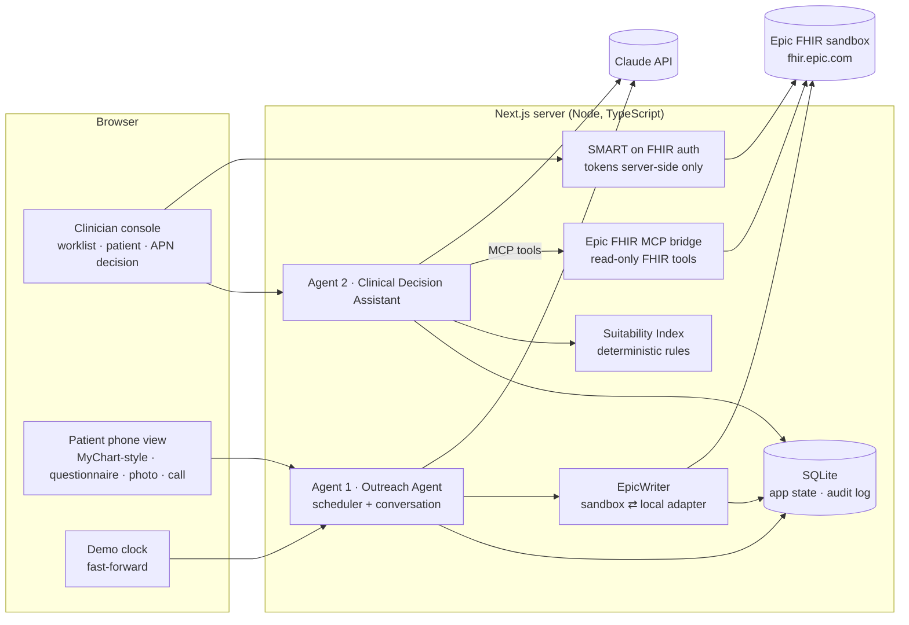
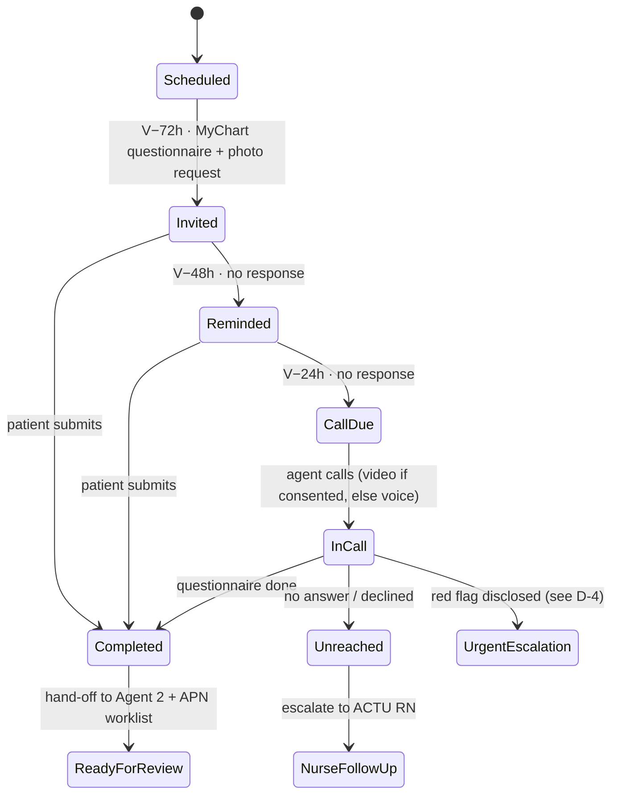

# ACTU Virtual Follow-Up — Proof-of-Concept Plan (two AI agents)

> **Purpose:** an engaging, Epic-connected demo for the MHA residency final presentation. **Not** a production product.
> **Status:** Draft for checkpoint. Supersedes the full-app phases where they conflict. `docs/pathway-spec.md` remains the clinical baseline from the report.
> **Data:** synthetic only (Epic sandbox test patients plus synthetic demo content). No real patient data or photos.

---

## 1. Scope change (Nov 26 brief + slides 8 and 11)

| Item | Before (report / original brief) | PoC scope now |
|---|---|---|
| Pre-visit screening | ACTU RN calls at V−72 to V−48 h | **Agent 1 (Outreach Agent):** MyChart questionnaire and photo request at **V−72 h** → reminder at **V−48 h** → **agent-led call within V−24 h** (video if the patient agrees, otherwise voice) |
| Decision support | APN reviews; AI is "future" (roadmap phase 4) | **Agent 2 (Clinical Decision Assistant):** analyzes the wound photo, the questionnaire and the Epic chart → **Virtual-care Suitability Index** with reasons and flags → **the APN decides** |
| Decision rule | Table 10: any "Yes" in 1 or 2 → *APN review* (in person **or phone advice**) | Slide 8: any "Yes" in 1 or 2 → **In person**; "No" in 3 → phone visit or local support; all clear → virtual visit |
| Answers this gives to Phase 1 questions | OQ-05 (MyChart flow in scope → **yes**), OQ-16 (AI in scope → **yes, as a PoC**) | |

---

## 2. What I verified about Epic (Nov 26, 2026)

Sources: the fhir.epic.com documentation page (fetched and read) and the sandbox's live `metadata` (CapabilityStatement, Epic November 2026 release).

### 2.1 The open.epic MCP server does **not** serve patient data
Quoted from the docs:
> "The open.epic MCP server lets AI clients … connect to **open.epic content**." It returns "API Specifications, Interface Summaries, Additional Documentation …, FAQs." "The MCP server is **not designated to handle sensitive information, such as protected health information (PHI)**."

- URL `https://mcp.open.epic.com`, Streamable HTTP. It's a **documentation** server, which is useful for developers but has nothing to do with patients.
- **Epic's patient-data MCP is not available yet.** The *Agent Factory Connectors* page (updated 11/18/2026) says: "For incoming connections, Epic will serve as the MCP server… Epic will start by making capabilities from its FHIR APIs available as MCP tools. These tools will let an agent **read** data available through Epic's USCDI v5 FHIR R4 APIs… in a **backend context**." Availability: **"by the end of Q1 2027."**

**Consequence and proposal:** Agent 2 reaches the chart through a **small MCP server we build** ("Epic FHIR MCP bridge"). It exposes read-only FHIR R4 tools backed by the real Epic sandbox, which is exactly the shape Epic has announced. In the presentation it is described honestly: *"a stand-in for Epic's incoming MCP connectors (Q1 2027); swap the URL when they ship."* The agent code doesn't change when that happens.

### 2.2 Sandbox connection facts
| Setting | Value |
|---|---|
| FHIR R4 base | `https://fhir.epic.com/interconnect-fhir-oauth/api/FHIR/R4` |
| Authorize / token | `…/interconnect-fhir-oauth/oauth2/authorize` / `…/oauth2/token` |
| Client ID | Use the **non-production client ID** in the sandbox. App changes take **up to 1 hour** to sync. |
| Registration fields | App name, consumer type (patient / clinician / backend), APIs, default FHIR version, redirect URIs, confidential client (needed for refresh tokens) |
| Clinician test login | `FHIRTWO` (has a linked provider record). Public sandbox account; you type it on Epic's own login page, never in chat. |
| MyChart test logins | Camila Lopez `fhircamila`, Derrick Lin `fhirderrick`, Desiree Powell `fhirdesiree` (public sandbox accounts) |
| Other test patients | Elijah Davis, Linda Ross, Olivia Roberts, Warren McGinnis (no MyChart login) |

### 2.3 Sandbox write support (from the live CapabilityStatement)
| Resource | Interactions | Used for |
|---|---|---|
| Patient, Condition, Procedure, AllergyIntolerance, MedicationRequest, Encounter, Practitioner | read / search (+ create on some) | Chart review (Agent 2) |
| **DocumentReference** | **create**, read, search, **update** | Read the OR note; **file the screening summary and APN decision note**; seed a synthetic OR note for the demo patient |
| **QuestionnaireResponse** | **create**, read, search | File the completed pre-visit questionnaire |
| **Communication** | **create**, read, search | Patient ↔ clinic message (MyChart-style) |
| **Observation** | **create**, read, search, update | Optional: patient-reported items |
| Task | read, search, **update** (no create) | — |
| **Appointment** | **read / search only** | ⚠ Can't change the visit type (virtual / in person) in the sandbox |
| **Media** | **read / search only** | ⚠ Can't file the wound photo as Media |
| Binary | read / search only | ⚠ Same |

⚠ **Not yet verified:** a server-wide "create" in the CapabilityStatement doesn't guarantee that *our* client, in *its* context, can create. Epic's per-API spec pages (which carry the sandbox notes) are rendered by JavaScript and couldn't be fetched. If you can, please paste the spec text for **QuestionnaireResponse.Create, Communication.Create and DocumentReference.Create (Clinical Notes)**. Otherwise I'll test each one on the first run with your client ID and **report any failure to you** rather than quietly work around it.

### 2.4 Epic surfaces that don't exist for third-party apps (no workaround in Epic)
- **Sending a MyChart push notification or message *to* a patient** from an external app: I found no documented API.
- **Phone or video calls:** outside Epic's APIs.

These become **simulated, clearly labelled** parts of the demo (§3).

---

## 3. Real vs. simulated in the demo

| Capability | In the PoC | Why |
|---|---|---|
| Clinician sign-in | **Real** SMART on FHIR (Epic sandbox, `FHIRTWO`) | — |
| Patient sign-in on the check-in page | **Real** SMART patient login (MyChart sandbox, e.g. `fhircamila`) | — |
| Reading the chart (demographics, conditions, procedures, notes, meds, vitals) | **Real** FHIR reads through our MCP bridge | — |
| Filing questionnaire / notes back to Epic | **Real** where §2.3 allows (QuestionnaireResponse, DocumentReference, Communication) — verified on first run | Appointment and Media are read-only → stored locally behind an `EpicWriter` interface ("deferred write") |
| Sternal-wire OR note | **Synthetic**, filed into the sandbox via DocumentReference.Create (or held locally if that fails) | Sandbox patients don't have one |
| MyChart notification at V−72 h / V−48 h | **Simulated** "MyChart-style" phone screen in the app | No outbound MyChart API (§2.4) |
| Agent call at V−24 h | **In-browser** voice conversation (speech-to-text / text-to-speech) driven by Claude; **video** = the patient's camera in the browser, used to capture the wound photo | Real telephony (PSTN, Twilio) is out of scope for a PoC |
| Time (72 / 48 / 24 h) | **Demo clock** you can fast-forward on stage | A live demo can't wait 3 days |
| Wound photos | **Synthetic images only** (decision D-3) | Never real patients |
| Suitability Index | **Illustrative, not validated.** Labelled as such on screen (report §8.3) | — |

---

## 4. Architecture

**Stack:**
- **Next.js + TypeScript:** one app; server routes keep tokens and the Claude key off the browser.
- **SQLite:** app-only state, the audit log and the demo clock.
- **`@anthropic-ai/sdk`:** Claude Opus 5.5 for both agents, with vision for the wound photo.
- **`@modelcontextprotocol/sdk`:** the MCP bridge, plus the agent's MCP client.
- **Browser Web Speech API:** voice. Works in Chrome or Edge, which is what you'd present from.
- **i18n EN/FR**, styled after UOHI with a placeholder logo, accessible (WCAG 2.1 AA).

**Offline fallback:** a **recorded-fixture mode** replays the Epic and Claude responses, so the demo still works if conference Wi-Fi fails.

---

## 5. Agent 1: Outreach Agent

**State machine (per patient, per follow-up visit V):**

**The call:**
- Claude runs a short, scripted conversation. It asks only the **10 Table 10 questions** in plain language (EN/FR) and confirms each answer back.
- It asks consent for video. With consent, it guides the patient to show the incision and captures a still image.
- Output: structured answers, the photo, and a transcript.

**Guardrails:**
- The agent **never gives clinical advice or reassurance**.
- It identifies itself as an automated assistant.
- On any red-flag answer it stops collecting and follows D-4.
- Everything it does is logged.

---

## 6. Agent 2: Clinical Decision Assistant

**Tools (through the MCP bridge, read-only):**
- `get_patient_summary`
- `list_conditions`
- `list_procedures`
- `find_operative_note` (DocumentReference search, plus note text)
- `list_medications`
- `get_recent_vitals`
- `get_questionnaire_response`

**Steps:**
1. **Wound photo** (vision): incision opening or gap, drainage, spreading redness, protruding suture or wire, photo usable or not. Each finding comes with a confidence and a short rationale.
2. **Questionnaire:** red flags (Wound / Symptoms) and digital readiness.
3. **Chart research:** closure method from the OR note (absorbable vs. retention/stay sutures → hands-on need), plus comorbidities.
4. **Index + recommendation** (§7), with a plain-language rationale and citations to the source (the photo, Q-item, or FHIR resource it relied on).

**APN screen:**
- Shows the photo, the answers, the flags, the index and the rationale side by side, with **Virtual visit** / **In person** / **Phone visit** buttons.
- The decision and the APN's note are filed to Epic (DocumentReference) and recorded in the audit log.
- **AI recommends, the APN decides.** No route is applied without a clinician's click.

---

## 7. Virtual-care Suitability Index (proposal, needs your approval: D-2)

The index is **deterministic and transparent.** The AI only *extracts findings*, and the arithmetic is plain code, so every point can be explained on stage and unit-tested.

| Component | Points | Source |
|---|---|---|
| No red flags in questionnaire (Wound + Symptoms all "No") | 30 | Questionnaire |
| Wound photo: no concerning findings (scaled by AI confidence; 0 if unusable) | 30 | Photo (vision) |
| No hands-on need: absorbable closure in OR note | 20 | OR note (FHIR) |
| Digital readiness: video-capable 10 · phone only 5 · neither 0 | 10 | Questionnaire |
| Data completeness: questionnaire complete · usable photo · OR note found | 10 | All |
| **Total** | **100** | |

**Gates** *(superseded by D-2: red flags now raise APN attention and never auto-route)*:
- **Any red flag** (questionnaire *or* a photo finding above a confidence threshold) → recommendation **In person**, with the score capped at 30.
- **Retention/stay sutures** → hands-on need → **In person** (or local removal; see D-1).
- "No" in the Patient section → **Phone visit or local support**.

**Patient characteristics** (diabetes, smoking, BMI, previous sternal wound infection…) **add 0 points.** They appear only as *attention flags* (e.g., "Diabetes: check photo carefully"). This follows the report's finding that no characteristic predicted a concern (rule R-11).

---

## 8. Demo script (~6 min)

1. **Worklist:** sign in to Epic (sandbox) as the APN. Three patients with follow-ups in 3 days, pulled from Epic.
2. **V−72 h:** fast-forward. Each patient's phone shows the MyChart-style prompt. *Camila* completes it on the phone (real MyChart sandbox login, photo upload) → filed to Epic.
3. **V−48 h:** *Derrick* hasn't responded → reminder.
4. **V−24 h:** still no response → **the agent calls Derrick** live in the browser. He agrees to video, answers the questions, and shows the incision.
5. **Agent 2:** open Camila → watch it read the chart through MCP (live tool trace), analyze the photo, and compute **86 / Virtual visit** with ✓ absorbable sutures, ✓ no red flags, ✓ incision intact, ⚠ diabetes: check photo.
6. **APN decides:** click *Virtual visit* → the note is filed to Epic → the audit trail is shown.
7. **Contrast case:** *Desiree* reported drainage → gated to **In person**, with the reasons shown.

---

## 9. FHIR mapping (PoC)

| Step | Resource / operation | Scope (SMART v2 style) | Sandbox | Fallback |
|---|---|---|---|---|
| Worklist / patient header | Patient.read/search | `patient/Patient.rs` · `user/Patient.rs` | ✅ read | — |
| Chart research | Condition, Procedure, MedicationRequest, Observation (vitals), AllergyIntolerance .search | `user/*.rs` | ✅ read | — |
| OR note | DocumentReference.search + Binary.read | `user/DocumentReference.rs`, `user/Binary.r` | ✅ read | Local synthetic note |
| Seed synthetic OR note | DocumentReference.create | `user/DocumentReference.c` | ⚠ to verify | Local store |
| Follow-up visit V | Appointment.search | `user/Appointment.rs` | ✅ read (likely no matching visit for test patients) | Local "planned follow-up" record |
| Questionnaire filed | QuestionnaireResponse.create | `patient/QuestionnaireResponse.c` | ⚠ to verify | Local + deferred write |
| MyChart-style message | Communication.create | `patient/Communication.c` | ⚠ to verify | Local |
| Wound photo | Media.create | — | ❌ read-only | Local (encrypted at rest), referenced in the note |
| Screening summary + APN decision | DocumentReference.create | `user/DocumentReference.c` | ⚠ to verify | Local + deferred write |
| Visit type change | Appointment.update | — | ❌ read-only | Local + deferred write |

---

## 10. What you need to do (Epic registration, ~15 min)

On fhir.epic.com → *Build Apps* → *Create*, make **two** apps:

1. **"ACTU Follow-Up (Clinician)":** consumer type *Clinicians or Administrative Users*; redirect `http://localhost:3000/api/auth/callback/clinician`; the read APIs in §9 plus DocumentReference.Create.
2. **"ACTU Follow-Up (Patient)":** consumer type *Patients*; redirect `http://localhost:3000/api/auth/callback/patient`; Patient.Read, QuestionnaireResponse.Create, Communication.Create.

Then:
- Mark each app *Ready for Sandbox* and wait up to 1 h.
- Put the **non-production client IDs** in `.env`. I'll give you the exact API checklist when we start.
- **No passwords in chat, ever.** The sandbox logins are typed only on Epic's page.

You'll also need a **Claude API key** for the agents. When we start, I'll request it through the secure credential form, never in chat. For your laptop, it goes in `.env`, which is gitignored.

---

## 11. Build order (vertical slices)

1. **Skeleton:** Next.js, UOHI-style shell, EN/FR, a11y basics, `.env.example`, SQLite, audit log, demo clock. Fixture mode first, so everything runs without keys.
2. **Epic connection:** SMART clinician login → worklist from sandbox patients → patient chart panel. Verify the writes in §2.3 and report results.
3. **MCP bridge + Agent 2:** tools, vision analysis, index (unit-tested), APN decision → DocumentReference.
4. **Agent 1, async:** V−72 / V−48 timeline, patient phone view, MyChart login, questionnaire + photo → QuestionnaireResponse.
5. **Agent 1, call:** in-browser voice/video conversation → structured answers.
6. **Polish for stage:** demo script mode, recorded fixtures, README, a short traceability table.

---

## 12. Decisions (answered by the project owner, 2026-11-26)

| ID | Decision |
|---|---|
| D-1 Sutures | **Show both, APN picks.** Retention-suture patients without red flags get two options: *local suture removal + short APN virtual check* and *in-person ACTU*, with distance to UOHI shown. |
| D-2 Index | **Out of 100, weights 30/30/20/10/10 kept.** A red flag is **flagged for APN attention and decision**; it does *not* force a route or cap the score (this supersedes the "gates" in §7). |
| D-2b Glycemia | Flag uncontrolled diabetes / high glycemia, using "the safest rule per guidelines". Implemented as the most sensitive defensible rule, since the flag only draws attention: HbA1c > 7.0 % (Diabetes Canada target), glucose > 10.0 mmol/L in the last 14 days (perioperative/in-hospital upper target), diabetes coded "with hyperglycemia", or a diabetic patient with no HbA1c in 6 months. **Needs clinical sign-off** (`lib/pathway/clinical-config.ts`). |
| D-3 Photos | **Generated synthetic images with a watermark** (`scripts/make_wound_images.py`). |
| D-4 Call | The agent **only collects** questionnaire answers and the wound photo (video). It opens every call with: *"This call only collects your answers for your care team. If you have an emergency, hang up and call 911."* |
| D-5 Hosting | **Laptop** for now; a web address may be needed later (add its redirect URIs in Epic and set `APP_BASE_URL`). |
| D-6 Branding | **Official UOHI 50-years logo** supplied by the owner (`public/logo-ohi.svg`). |
